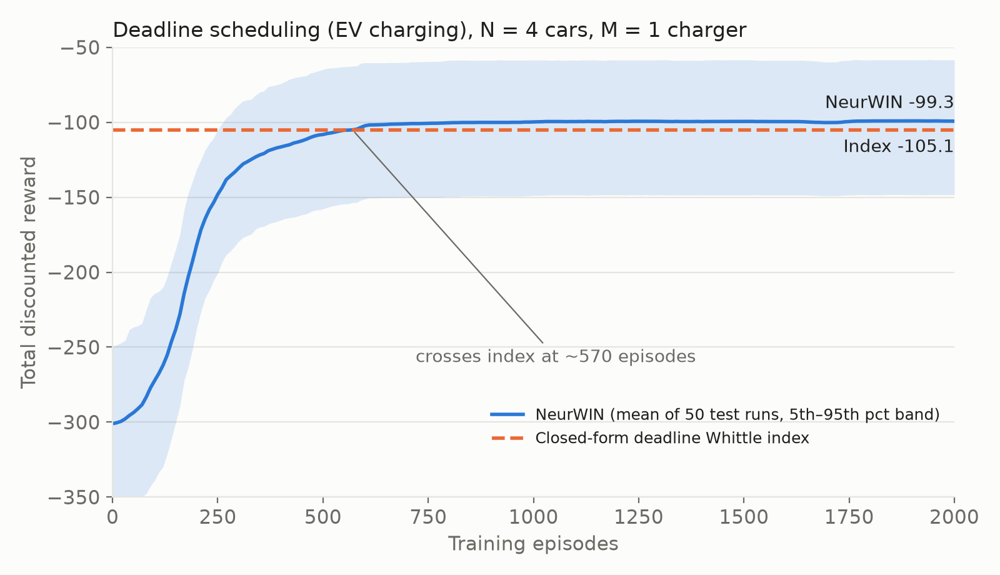

# Replication: NeurWIN deadline scheduling (EV charging), N = 4, M = 1

Source code: https://github.com/khalednakhleh/NeurWIN (authors' code, their LICENSE kept).
Paper: Nakhleh et al., *NeurWIN: Neural Whittle Index Network for Restless Bandits via Deep RL*, NeurIPS 2021, Figure 2.

## Result

| Training episodes | NeurWIN mean reward (50 test runs) |
|---|---|
| 0 | -301.0 |
| 200 | -181.6 |
| 400 | -116.4 |
| 600 | -102.3 |
| 2,000 | -99.3 |
| Closed-form deadline Whittle index | -105.1 |

NeurWIN first reaches the index at the 570-episode checkpoint (paper: about 600).
It ends 5.8 above the index, better in all 50 runs (paired SE 0.35).



## Changes to the authors' code

Algorithm, environment and hyperparameters are unchanged. Every edit is marked `REPLICATION` or `COMPAT FIX`.

| File | Change | Why |
|---|---|---|
| `neurwin.py` | `zero_grad()` -> `zero_grad(set_to_none=False)` (2 places) | PyTorch >= 2.0 sets grads to None, which crashes the batch update |
| `testingScripts/testDeadlineScheduling.py` | `seed=int(envSeeds[i])` (2 places) | Python 3.11+ rejects numpy ints in `random.Random()` |
| `main.py` | uncomment only the deadline block; `sigmoidParam = 1`, `numEpisodes = 2000`, `episodeSaveInterval=10` | Paper's settings for this example |
| `testingScripts/testDeadlineScheduling.py` | `ARMS = 4`, `SCHEDULE = 1`, `EPISODERANGE = 10`; uncomment closed-form and NeurWIN blocks | The N = 4, M = 1 panel |

Environment: Python 3.13, torch 2.15 CPU, numpy 2.5, gym 0.26.2, GPy 1.15 (imported by `main.py`).

## How to run

```bash
python main.py                                   # trains, ~3.3 min on CPU
cd testingScripts && python testDeadlineScheduling.py   # ~12 min
cd .. && python replication/curve.py curve . replication/out/curve_N4.csv
python replication/curve.py scale . replication/out/scale.csv
python replication/plot.py replication/out
```

`replication/curve.py` is a faster copy of the authors' test loop (network turned into a lookup table).
It matches the authors' script on all 50 runs x 201 checkpoints to within 6e-14.

## Extra checks on the 5.8 gap (`replication/`)

- `gap_check.py`: tie-breaking in the closed-form index does not explain it (changes of -0.04 to +0.44).
- `disagree.py`: the policies pick differently in 40% of decisions; the index charges the car leaving now, NeurWIN often charges a car with a few steps left and a large remaining charge.
- `curve.py scale` (same trained net, M = N/4):

| N, M | NeurWIN - index | % of index | NeurWIN better in |
|---|---|---|---|
| 4, 1 | +5.8 | +5.5% | 50/50 |
| 8, 2 | +8.7 | +4.5% | 50/50 |
| 20, 5 | +8.0 | +1.7% | 49/50 |
| 100, 25 | -43.5 | -2.0% | 0/50 |

The edge shrinks as N grows and flips at N = 100, consistent with the Whittle index being optimal only as N grows large. N = 100 uses the 2,000-episode net (repo default is 30,000), so it may be under-trained. One training seed only.
