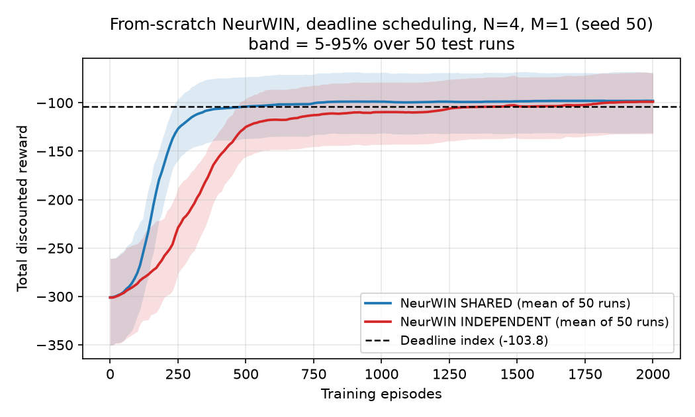
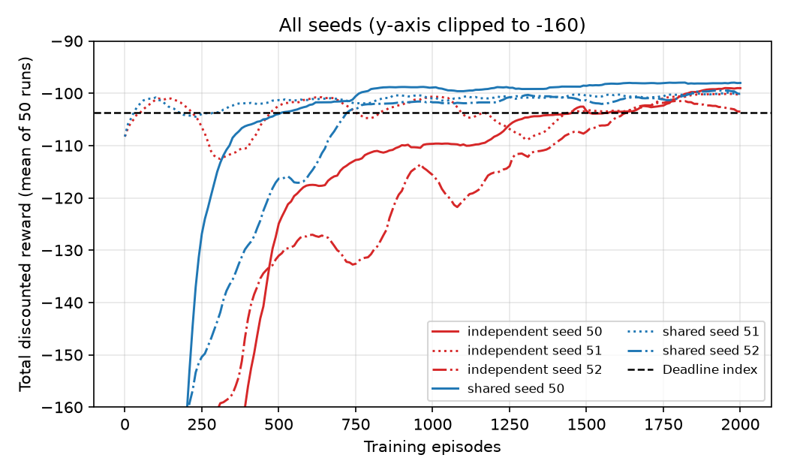

# From-scratch rebuild: NeurWIN deadline scheduling (Sec. 5.2)

Question: does Algorithm 1, as written in the paper, reproduce the
deadline-scheduling result on its own?

Clean room: built only from `paper/restless_bandit.pdf` (Secs. 3.3, 4.1,
4.2, 5.1, 5.2) plus the assumptions listed below. Nothing in `NeurWIN/` or on
GitHub was opened. The full spec, with page references, is in
[SPEC.md](SPEC.md).

## Files

| File | What it is |
|---|---|
| `SPEC.md` | every quantity, where the paper states it, and every assumption |
| `arm.py` | one-arm simulator (Sec. 3.3), round dynamics, closed-form index W(D,B) |
| `network.py` | f_theta: 2 → 16 → 32 → 1, ReLU (Sec. 5.1) |
| `algorithm1.py` | Algorithm 1, commented with its line numbers; `--variant shared|independent --seed S` |
| `evaluate.py` | Sec. 5.1 test (N=4, M=1, 300 rounds, 50 runs) for every checkpoint and for W; Spearman f_theta vs W |
| `report.py` | `out/curve.png`, `out/curve_seeds.png`, `out/table.md` |
| `out/results.json` | every number behind the plots and tables |

Reproduce (about 30 s total, repo-root `.venv`):

```
cd from_scratch
for s in 50 51 52; do for v in shared independent; do ../.venv/bin/python algorithm1.py --variant $v --seed $s; done; done
../.venv/bin/python evaluate.py && ../.venv/bin/python report.py
```

Checkpoints (`out/ckpt_*.pt`) are not committed; each training run takes
about 2 s to regenerate.

## What came from the paper

Algorithm 1 and Eq. (1) (Sec. 4.2): s0, s1 drawn once per mini-batch;
λ = f_theta(s0); actions sampled with σ_m(f_theta(s_t) − λ); score-function
sums h_e; discounted net reward G_e; mini-batch mean G_bar_b as the baseline;
ascent on Σ_e (G_e − G_bar_b) h_e. Sec. 5.1: network 2-16-32-1 with ReLU,
Adam, L = 0.001, β = 0.99, horizon 300, R = 5, N = 4 / M = 1, top-M by
index, 50 runs, total discounted reward. Sec. 5.2: state (D, B), B ≤ 9,
D ≤ 12, 120 states, reward 1 − c per unit, penalty F(B) on departure.

## What was assumed (not in this PDF)

- From ref [34], via your replication notes: c = 0.5; F(B) = 0.2 B²;
  arrival prob 0.7; D in 1..12, B in 1..9; the closed-form index W.
- From the paper's appendix (not in this PDF), via your notes: m = 1.
- My choices, which you approved: new vehicles uniform and independent in
  (D, B); the empty spot is (0, 0); the 120 states are D 1..12 × B 0..9;
  raw integer input; λ held fixed (no gradient through it); constant
  learning rate; 2,000 episodes = 400 mini-batches; each test run starts with
  4 fresh vehicles; the same randomness for every policy in run k (seed k).
- Round timing: the departure penalty is paid in the vehicle's last round
  (D = 1). The new vehicle appears in the next state. This is the only
  timing that matches the β^(D−1) factor in W. Value iteration confirms
  that Q_act = Q_pass at λ = W(s) for all 108 vehicle states (max gap
  2e-14), so the simulator and the index are consistent.
- **Tie-breaking:** the test breaks equal scores uniformly at random. The
  closed-form index gives exactly 0.5 to every state with B ≤ D − 1, so
  ties are common for the index policy. **The authors' setup may break ties
  differently** (for example, always the lowest arm number). That can move
  the index's reward and therefore every "≥ index" comparison. f_theta
  outputs are continuous and almost never tie.

## Results (N = 4, M = 1, 50 test runs)



Seed 50, both variants. Bands are 5–95% across the 50 test runs; the dashed
line is the closed-form index (−103.8).

| variant | seed | first ckpt ≥ index | stays ≥ index from | reward @2000 | index | diff (paired SE) | runs won /50 | rank corr @2000 |
|---|---|---|---|---|---|---|---|---|
| SHARED | 50 | 510 | 510 | −98.0 | −103.8 | +5.7 (0.4) | 50 | 0.81 |
| SHARED | 51 | 30* | 290 | −100.1 | −103.8 | +3.7 (0.4) | 46 | 0.82 |
| SHARED | 52 | 730 | 730 | −100.1 | −103.8 | +3.6 (0.4) | 45 | 0.78 |
| SHARED | **mean** | 423 | 510 | −99.4 | −103.8 | +4.3 | 47 | 0.80 |
| INDEPENDENT | 50 | 1460 | 1570 | −99.0 | −103.8 | +4.7 (0.4) | 48 | 0.72 |
| INDEPENDENT | 51 | 50* | 1440 | −100.2 | −103.8 | +3.5 (0.4) | 45 | 0.79 |
| INDEPENDENT | 52 | 1630 | 1630 | −103.5 | −103.8 | +0.2 (0.5) | 27 | 0.70 |
| INDEPENDENT | **mean** | 1047 | 1547 | −100.9 | −103.8 | +2.8 | 40 | 0.74 |

"First ckpt ≥ index" is the metric you specified: the first checkpoint whose
50-run mean is at least the index's. "Stays ≥ index from" is a second
column: the first checkpoint after which the mean never drops below the
index again. It doesn't change any result.

\* Seed 51's **untrained** network already scores −108, close to the index;
the other seeds start near −300. Its early "crossing" (30–50 episodes) is
that lucky start drifting up a few points, not learning. Under INDEPENDENT
it then falls back below the index for a long time
(see `out/curve_seeds.png`).



## Comparison with your replication of the authors' code

| | yours (authors' code) | from scratch, SHARED (seeds 50/51/52) | from scratch, INDEPENDENT |
|---|---|---|---|
| NeurWIN final | −99.3 | −98.0 / −100.1 / −100.1 | −99.0 / −100.2 / −103.5 |
| Index | −105.1 | −103.8 | −103.8 |
| First ≥ index | 570 | 510 / (30*) / 730 | 1460 / (50*) / 1630 |
| Rank correlation | 0.78 | 0.81 / 0.82 / 0.78 | 0.72 / 0.79 / 0.70 |

Judged by behavior:

- **Crosses the index between ~400 and ~900 episodes?** SHARED: yes for
  seeds 50 (510) and 52 (730). Seed 51 starts at the index and stays near
  or above it, holding above from 290. INDEPENDENT: no. It crosses for good
  only at 1,440–1,630 episodes, about 2–3× later.
- **Ends near or above the index?** Yes, in all six runs. SHARED ends 3.6–5.7
  above, winning 45–50 of the 50 paired runs. INDEPENDENT ends 0.2–4.7
  above; seed 52 is only tied (+0.2 ± 0.5, 27/50 wins).
- **Ranks states similarly?** Yes. Spearman 0.78–0.82 (SHARED) and 0.70–0.79
  (INDEPENDENT), against your 0.78. f_theta is not Whittle-accurate in the
  Def. 4 sense: it orders states roughly like W, not exactly.

**Does SHARED vs INDEPENDENT matter? Yes, mostly for speed.** With the
same seed, initial θ and s0/s1 draws, SHARED reaches the index 2–3× sooner,
and ends a little higher on average (+4.3 vs +2.8) with better state ranking
(0.80 vs 0.74). The likely reason: in this arm, departures happen at fixed
times whatever the actions are. So under SHARED, the R = 5 episodes of a
mini-batch have identical vehicle timelines and differ only through the
actions. G_e − G_bar_b then measures the effect of the actions, not luck in
arrivals, and the gradient is much less noisy. The paper doesn't say which
one it does; the timing in Sec. 5.2 ("converges … in 600 training episodes")
and your 570 match **SHARED**.

**Bottom line:** Algorithm 1 as written, plus the listed assumptions,
reproduces the result: it ends at or a few points above the closed-form
index and ranks states about as well as the authors' code (~0.8). It reaches
the index on the paper's ~600-episode timescale only when the episodes of a
mini-batch share their arriving vehicles. With fresh arrivals per episode it
gets there, but 2–3× later. Nothing was tuned: every setting is the paper's,
your assumption, or a SPEC choice fixed before training. Three seeds is a
small sample, so the exact crossing episodes are rough.
